# Pavlodar Green

## Презентация проекта

[▶ Смотреть презентацию (PDF)](presentation/Pavlodar_Greening_Final.pdf) · [▶ Смотреть финальное демо-видео](presentation/Pavlodar_Greening_Demo_60s.mp4) · [Скачать PowerPoint со встроенным видео](presentation/Pavlodar_Greening_Final.pptx)

> Для первого знакомства: откройте PDF, затем минутное видео. Для показа без интернета скачайте PowerPoint — ролик уже встроен в пятый слайд.

<p align="center">
  
</p>

<p align="center"><strong>Цифровая платформа управления озеленением Павлодара — от городской карты и проекта участка до бюджета, исполнения и контроля результата.</strong></p>

<p align="center">
  
  
  
  
  
  
</p>

Pavlodar Green объединяет пространственные данные, проектирование посадок, серверные расчёты, 2D/3D-анализ, городское планирование и фактическое исполнение в одной системе. Все значимые результаты сохраняются как воспроизводимые версии: карта и интерфейс показывают те же данные, которые использует сервер для расчётов, отчётов и решений.

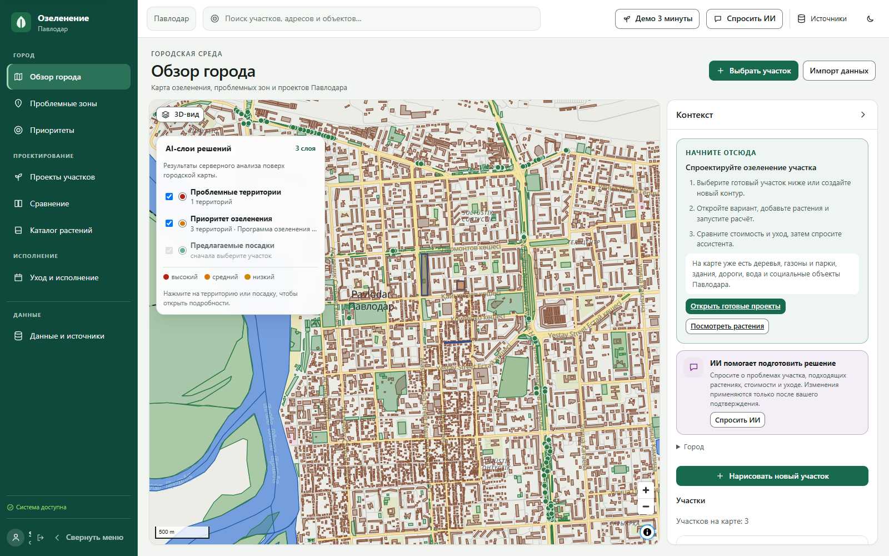

## Платформа уже наполнена и готова к показу

| Городской контур | Проектирование | Поддержка решения |
|---|---|---|
| **60 144** объектов Павлодара | **3** проектных участка | **9** проектных вариантов |
| **8** семейств картографических слоёв | **9** растений с характеристиками | **1** городская программа из 9 кандидатов |
| 2D-карта, 3D-здания и серверные тени | стандартный, водосберегающий и теневой варианты | работающий ИИ с фактами текущего проекта |

Главная ценность Pavlodar Green — не отдельная карта или чат, а непрерывный маршрут решения:

**городские данные → проблемная территория → проект участка → сравнение вариантов → городская программа → работы и контроль результата.**

## Что уже умеет платформа

- интерактивная карта Павлодара на MapLibre с MVT/PMTiles и уровнями детализации;
- 60 144 городских объекта: здания, дороги, зелёные территории, деревья, вода и социальная инфраструктура;
- импорт GeoJSON, CSV, KML и SHP ZIP через карантин, проверку качества и управляемую публикацию;
- выбор, рисование и версионирование зон с серверным расчётом площади;
- каталог растений, правила применимости, складские предложения и версии ставок;
- неизменяемые сценарии, расстановка растений, блокировки и защита от конфликтов;
- серверная смета в KZT, расчёт ухода, survival и сравнение вариантов;
- синхронное представление участка в 2D и 3D, высоты зданий, расчёт теней и контур теплового моделирования;
- версионированные экологические коэффициенты и обязательные показатели на горизонтах 5/10/20 лет;
- приоритизация зон и оптимизация городской программы с бюджетными и ресурсными ограничениями;
- рабочие задания, частичное выполнение, корректировки, осмотры, когорты и замены;
- PDF/XLSX-отчёты из зафиксированного снимка расчёта;
- ассистент с ограниченным набором инструментов, ссылками на серверные факты и ручным подтверждением изменений;
- роли `viewer`, `specialist`, `admin`, городские grants, доступ к наборам и полный audit trail.

## Почему Pavlodar Green должен выиграть

**Это не презентационный макет, а связанная работающая система.** Один пользовательский маршрут проходит через настоящий API, PostGIS, очереди, фоновые расчёты и неизменяемые версии — от объекта на карте до задания исполнителю и отчёта.

1. **Город уже наполнен данными.** На карте опубликовано 60 144 объекта Павлодара, доставляемых через MVT/PMTiles, а не встроенный в интерфейс GeoJSON.
2. **Решение закрывает весь жизненный цикл.** Анализ территории, проект посадок, смета, 2D/3D, тени, городская программа, исполнение, осмотр и экспорт работают в одной модели данных.
3. **Цифры считает сервер.** Стоимость, площади, ограничения, приоритеты и результаты фоновых заданий воспроизводимы и привязаны к точным версиям входов.
4. **ИИ встроен в процесс принятия решений.** Он получает разрешённые серверные факты, объясняет результат и подготавливает проверяемое предложение, но не меняет проект без специалиста.
5. **Система рассчитана на реальную эксплуатацию.** OIDC, роли и grants, audit trail, защита от конфликтов, idempotency, retry/cancel, резервное копирование и восстановление реализованы в основном контуре.
6. **Платформа расширяется без переписывания.** Новые городские наборы, тарифы, правила, модели и LLM-провайдеры подключаются через версионируемые контракты и реестры.

Pavlodar Green показывает не только красивое будущее города, но и практический механизм, с помощью которого специалист может спроектировать, обосновать, утвердить и проконтролировать озеленение.

[Матрица соответствия каждому пункту исходного ТЗ жюри](docs/JURY_ACCEPTANCE_MATRIX.md) · [Одностраничный маршрут демонстрации](docs/QUICK_DEMO_GUIDE.md)

## Посмотрите за три минуты

1. Войдите как специалист и откройте городскую карту.
2. Откройте «Проекты участков»: для трёх территорий уже подготовлено девять вариантов озеленения.
3. Выберите водосберегающий вариант — на первом экране видны состав из девяти растений, стоимость и прогноз приживаемости через год; полный расчёт остаётся ниже.
4. Нажмите «Спросить ИИ» — ассистент объяснит сильные стороны именно открытого проекта и покажет серверные факты.
5. В «Сравнении» сопоставьте водосберегающий и теневой варианты: быстрый вывод сразу покажет минимальную стоимость и минимальный полив, а карточки — уход и приживаемость.
6. Вернитесь на карту, включите 3D и покажите объёмы зданий и рассчитанную тень на выбранный момент.
7. Откройте городскую программу: все девять проектов собраны в единый бюджетный контур. Измените лимит и пересчитайте — новая версия покажет, какие проекты вошли и вышли.
8. Завершите показ разделом «Уход и исполнение»: он связывает утверждённый проект с бригадами, фактом работ и осмотрами.

## Платформа изнутри

### Городская карта и 3D-контекст

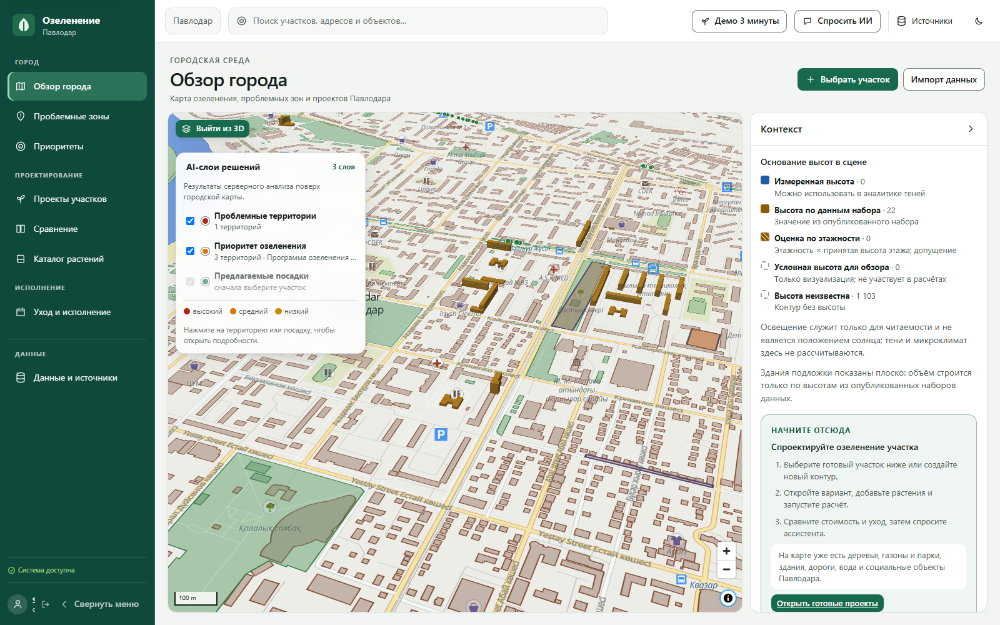

Карта не является фоновой иллюстрацией. Объекты приходят из опубликованных серверных версий, выбираются по стабильному идентификатору и участвуют в пространственном контексте, 3D и фоновых расчётах. Один и тот же участок открывается в 2D и 3D без потери выбранного объекта, камеры и версии данных.

### Проект участка и история решений

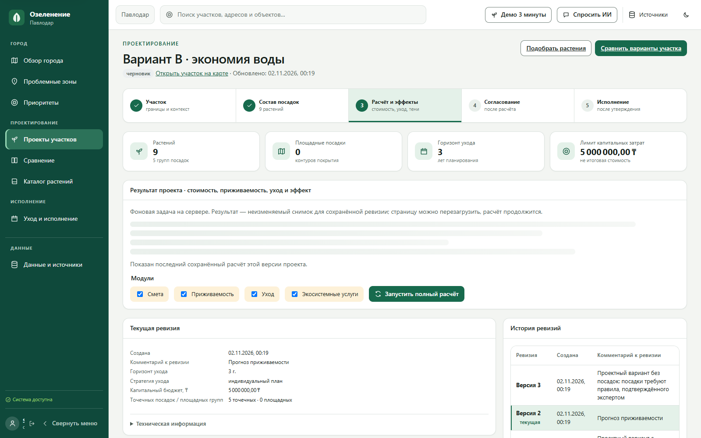

Специалист задаёт горизонт и стратегию ухода, бюджет и размещение растений. Каждое сохранение создаёт новую ревизию: предыдущий вариант остаётся доступен для сравнения, расчёта и аудита. Площадь, смета, приживаемость и ограничения вычисляются сервером, а не браузером.

### Портфель проектов и сравнение вариантов

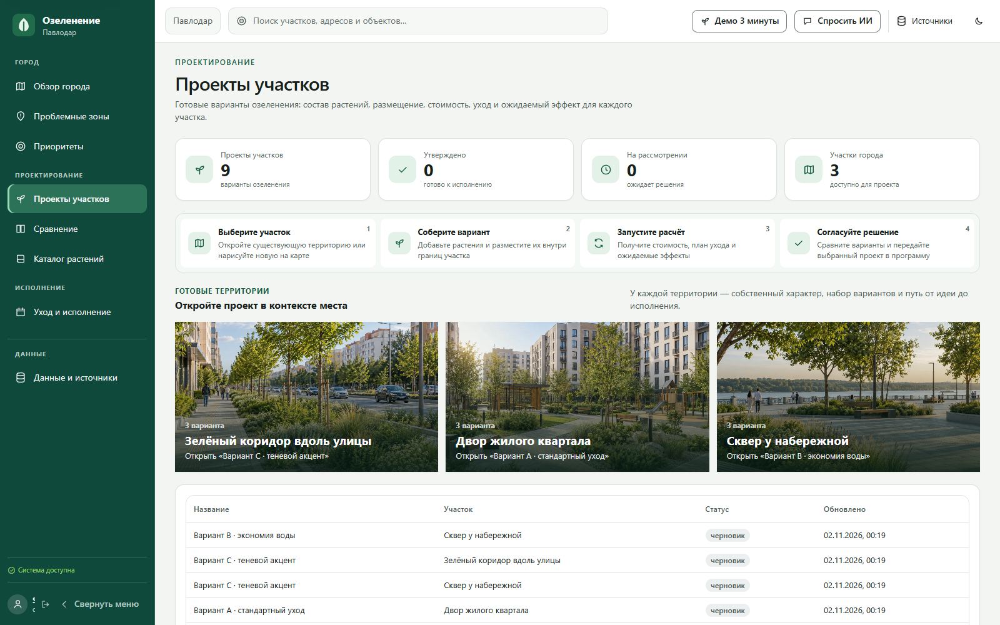

Для каждого участка подготовлены три стратегии: стандартный уход, экономия воды и теневой акцент. Это не дублированные карточки: каждый вариант хранит собственный состав посадок, ограничения, расчёт и историю изменений.

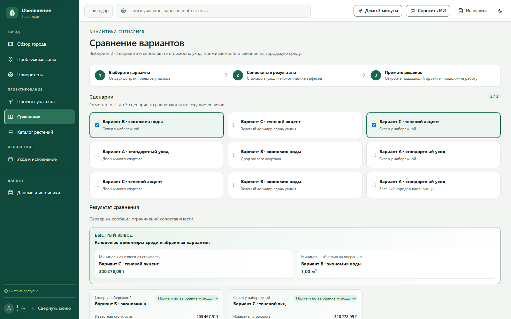

Сравнение читает зафиксированные серверные снимки и сопоставляет стоимость, уход, приживаемость и экологические эффекты. Пользователь видит понятное резюме; полная таблица метрик остаётся доступна в раскрываемом экспертном блоке.

### Проблемы территорий и городская программа

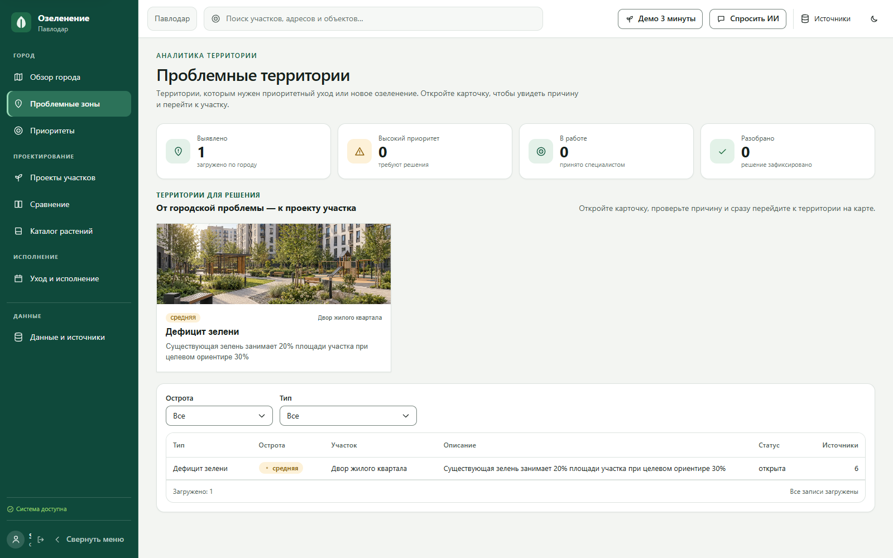

По каждому участку платформа собирает обязательные проверки из пространственного контекста. Специалист сразу понимает, какие данные нужны перед согласованием, и одним действием возвращается к территории на карте.

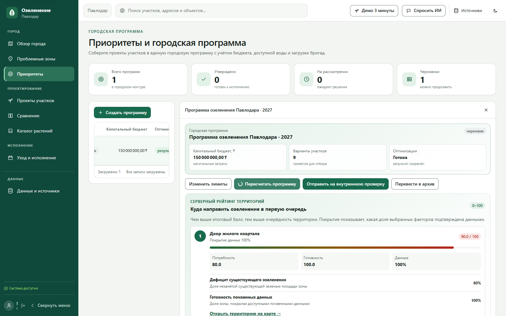

Городская программа объединяет девять вариантов, бюджет, приоритеты и ресурсные лимиты. Выбранный портфель открывается по точным ревизиям проектов, а повторный расчёт создаёт новую версию и показывает разницу: бюджет, добавленные и исключённые проекты. Сервер не выдаёт псевдооптимальный результат при неполной смете: запуск становится доступен только после готовности всех входных расчётов.

### Исполнение и контроль результата

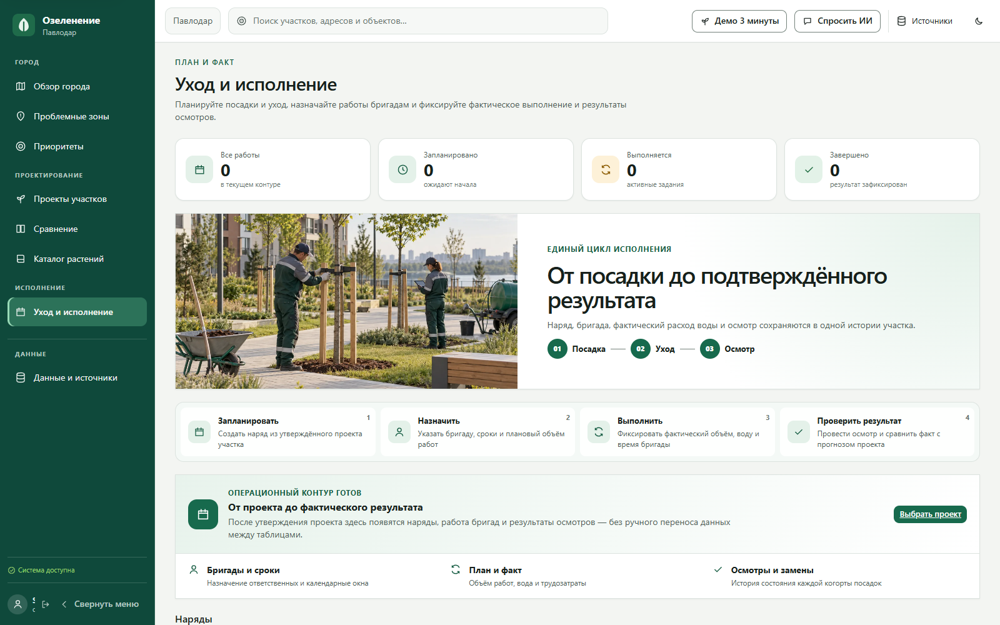

После утверждения проекта тот же контур продолжается в исполнении: создаётся наряд, назначается бригада, фиксируются фактические объёмы, вода и трудозатраты, а осмотры формируют историю когорт и замен.

### Каталог растений с правилами применимости

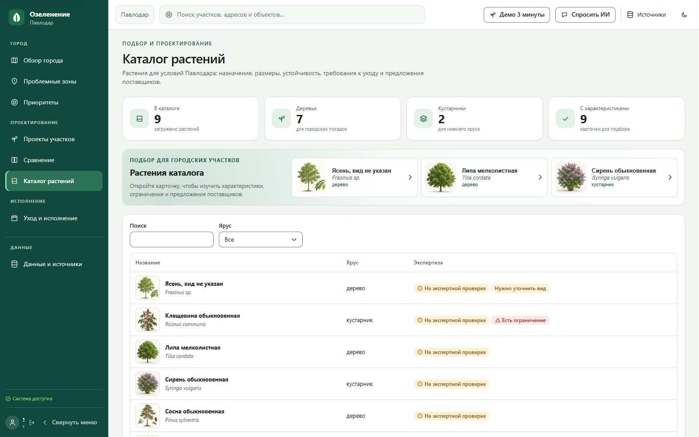

Каталог соединяет виды и сорта, ботанические характеристики, версии правил, ограничения для чувствительных объектов и доступные складские предложения. Неизвестные параметры не подменяются догадками: они видны специалисту и могут блокировать утверждение проекта.

### Контекстный ИИ-ассистент

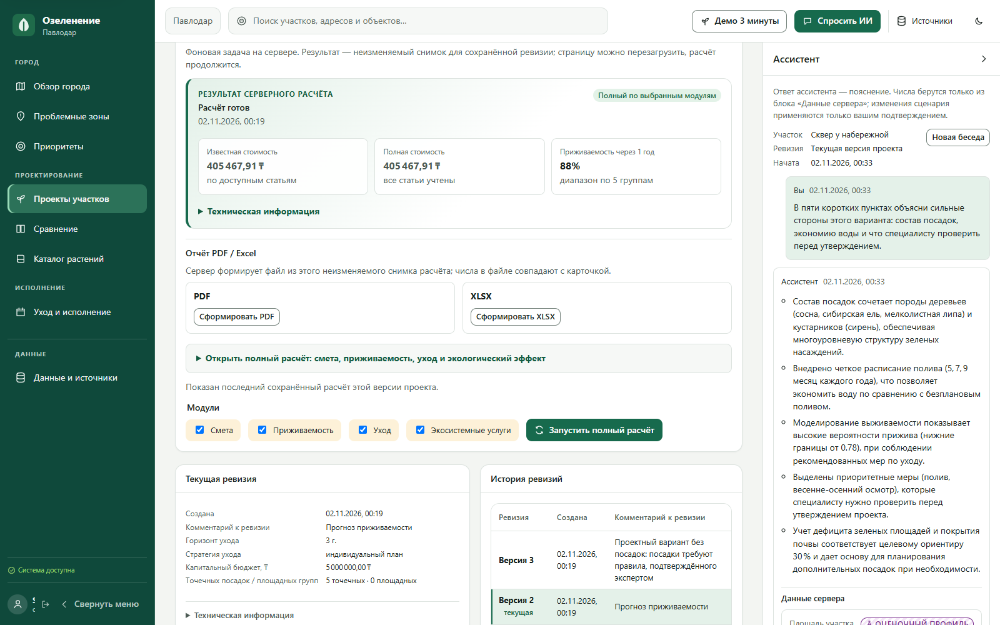

Ассистент открывается поверх рабочего экрана и получает только выбранный пользователем контекст. На снимке показан реальный ответ работающего провайдера: он объясняет состав посадок и перечисляет проверки, а площадь берёт из отдельного блока серверных фактов. Предлагаемое изменение применяется только после подтверждения специалиста.

## Как работает платформа

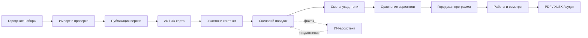

1. **Данные входят через управляемый импорт.** GeoJSON, CSV, KML или SHP ZIP сначала попадают в карантин, проходят структурные и пространственные проверки и только затем публикуются новой неизменяемой версией.
2. **Карта собирает единый городской контекст.** Здания, дороги, вода, зелёные территории, деревья и социальные объекты доставляются тайлами; права доступа проверяются сервером для каждого набора.
3. **Специалист выбирает или рисует участок.** Сервер валидирует геометрию, считает площадь и сохраняет историю границ. К участку привязываются все последующие решения.
4. **Проект создаётся как последовательность ревизий.** В редакторе размещаются растения, выбираются правила, ставки, поставщики и стратегия ухода. Параллельные правки защищены `ETag`/`If-Match`.
5. **Сервер выполняет расчёты.** Фоновые задания считают стоимость в KZT, потребность в уходе, приживаемость, пространственные ограничения и тени; тепловой запуск допускается только с закреплёнными погодой и параметрами. Каждый результат хранит точные версии всех входов.
6. **Варианты сравниваются и входят в городскую программу.** Оптимизатор помогает выбрать набор проектов при заданном бюджете, доступных ресурсах и приоритетах районов.
7. **Решение доводится до исполнения.** Из утверждённого проекта формируются рабочие задания; фактические объёмы, осмотры, когорты и замены возвращаются в тот же контур.
8. **Результат объясним и переносим.** PDF/XLSX, карта, 3D и ассистент читают один calculation snapshot, поэтому цифры не расходятся между экранами и отчётами.

## Данные Павлодара

Опубликованный городской слой построен из лицензированных открытых данных и проходит через тот же версионируемый контур импорта, что и подключаемые муниципальные наборы.

| Категория | Объектов |
|---|---:|
| Здания | 49 552 |
| Дороги | 7 746 |
| Зелёные территории | 1 043 |
| Деревья | 426 |
| Водные объекты | 167 |
| Социальные и городские объекты | 1 210 |
| **Всего** | **60 144** |

Геометрия хранится в EPSG:4326, а расстояния и площади вычисляются сервером в EPSG:32643. Каждый опубликованный объект сохраняет связь с версией набора и исходной записью.

## Архитектура

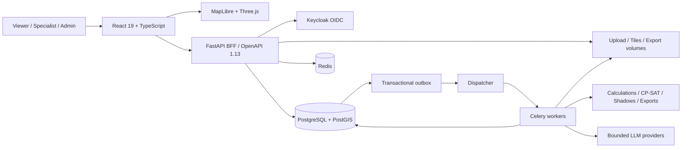

### Почему результат воспроизводим

- опубликованные версии наборов и сценариев неизменяемы;
- новая правка создаёт новую ревизию, а не переписывает историю;
- `ETag`/`If-Match` защищают от потерянных параллельных изменений;
- деньги передаются Decimal-строками в KZT, неизвестное значение никогда не превращается в ноль;
- расчёты, оценки и ограничения принадлежат серверу, браузер не содержит альтернативных формул;
- фоновые задания имеют idempotency, retry, cancel, lease fencing и атомарную публикацию результата;
- PDF, XLSX, карта и ассистент ссылаются на один зафиксированный calculation snapshot;
- права повторно проверяются при чтении, постановке задания и сохранении результата.

## ИИ-ассистент: роль в платформе

Ассистент — не отдельный чат и не генератор произвольных советов. Он работает внутри текущего контекста специалиста: город → участок → точная ревизия проекта. Перед ответом сервер формирует разрешённый набор фактов и самостоятельно проверяет права пользователя.

Ассистент умеет:

- объяснить площадь, состав проекта, известную стоимость и блокирующие ограничения;
- найти нужный расчётный снимок и сослаться на конкретные серверные факты;
- объяснить, почему проект нельзя перевести на следующий этап;
- подготовить изменение количества в выбранном размещении;
- показать точную исходную ревизию и срок действия предложения;
- передать предложение специалисту на явное подтверждение или отклонение.

ИИ не записывает изменения напрямую. Даже корректное предложение применяется отдельной серверной операцией с актуальным `If-Match`; устаревшая ревизия отклоняется без потери пользовательской работы.

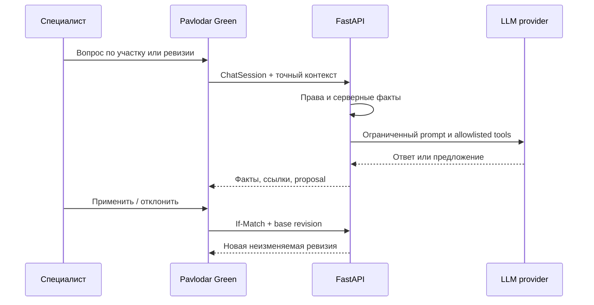

## Быстрый запуск

### Одна команда для готового конкурсного стенда (Windows)

После клонирования репозитория одна команда устанавливает зафиксированные зависимости, поднимает PostGIS, Keycloak, Redis, API и workers, создаёт роли, загружает данные Павлодара и открывает интерфейс:

```powershell
powershell -ExecutionPolicy Bypass -File tools/dev/start-demo.ps1
```

При повторном запуске можно пропустить установку зависимостей:

```powershell
powershell -ExecutionPolicy Bypass -File tools/dev/start-demo.ps1 -SkipInstall
```

В конце команда выводит локальный логин специалиста и пароль из игнорируемого файла `.local/test-credentials.json`. Ключи LLM остаются только в локальной `.env` и никогда не входят в репозиторий.

### Требования

- Docker Desktop с Compose;
- [uv](https://docs.astral.sh/uv/);
- Node.js `22.20.0` и npm;
- свободные локальные порты `5173`, `8001`, `8081`, `5433`, `6381`.

Версии Python и Node зафиксированы в `.python-version` и `.node-version`.

### 1. Подготовка

```powershell
git clone https://github.com/Mustiks07/pavlodar-green-platform.git
cd pavlodar-green-platform

uv python install 3.12.11
uv sync --locked
npm ci --prefix apps/web

uv run python tools/dev/bootstrap.py
```

Bootstrap создаёт локальные случайные секреты в игнорируемых `.env`, `infra/keycloak-test-realm.json` и `.local/test-credentials.json`. Их нельзя добавлять в git или передавать в сообщения.

### 2. Инфраструктура и API

```powershell
docker compose --env-file .env -f infra/compose.yml --profile test up -d --build --wait
uv run python -m tools.dev.seed --profile test
```

Compose поднимает PostGIS, Redis, Keycloak, миграции, API, dispatcher и worker. Проверка готовности:

```powershell
Invoke-RestMethod http://localhost:8001/health/ready
```

### 3. Веб-приложение

В отдельном терминале:

```powershell
$env:PG_API_ORIGIN = "http://127.0.0.1:8001"
npm --prefix apps/web run dev -- --host localhost --port 5173
```

Откройте:

- интерфейс: <http://localhost:5173>;
- API: <http://localhost:8001>;
- OpenAPI: <http://localhost:8001/openapi.json>;
- Keycloak: <http://localhost:8081>.

Для OIDC используйте именно `localhost`, а не `127.0.0.1`: callback и Origin проверяются строго.

### Вход для проверки

Основная роль для показа проекта жюри:

- логин: `specialist`;
- пароль: случайно создаётся локальным bootstrap и хранится в `.local/test-credentials.json`.

Показать пароль специалиста в локальном терминале:

```powershell
$credentials = Get-Content .local/test-credentials.json -Raw | ConvertFrom-Json
[pscustomobject]@{
  Login = "specialist"
  Password = $credentials.specialist
}
```

Для проверки разграничения прав доступны также `viewer` и `admin`; их пароли находятся в том же локальном файле. В репозитории нет общего фиксированного пароля, поэтому публичная копия проекта не содержит рабочий секрет.

### 4. Наполнение рабочего контура

Команда идемпотентно создаёт городские зоны и проекты через публичный HTTP API:

```powershell
uv run python -m tools.dev.demo_bootstrap --license "CC-BY-4.0"
uv run python -m tools.dev.demo_bootstrap --check
```

Локальные роли `viewer`, `specialist` и `admin` создаются bootstrap-скриптом. Пароли находятся только в игнорируемом `.local/test-credentials.json`.

## Подключение ИИ за одну минуту

По умолчанию внешний провайдер выключен: репозиторий не содержит общих API-ключей. Каждый разворачивающий платформу добавляет собственный ключ только в локальный игнорируемый `.env`.

### Безопасная настройка в Windows

Скрипт запрашивает ключ скрытым вводом, не печатает его и при `-Restart` перезапускает worker:

```powershell
# Gemini
.\tools\dev\configure-llm.ps1 -Provider gemini -Restart

# Groq
.\tools\dev\configure-llm.ps1 -Provider groq -Restart

# OpenRouter: идентификатор модели задаётся явно
.\tools\dev\configure-llm.ps1 -Provider openrouter -Model "provider/model" -Restart
```

Поддерживаемые переменные для ручной настройки:

```dotenv
PAVLODAR_LLM_PROVIDER=gemini
PAVLODAR_GEMINI_API_KEY=put-your-key-in-local-env-only
PAVLODAR_GEMINI_MODEL=gemini-3.5-flash-lite

# Необязательный fallback, если добавлены соответствующие ключи:
PAVLODAR_LLM_FALLBACK_PROVIDERS=groq,openrouter
```

Для Groq используются `PAVLODAR_GROQ_API_KEY` и `PAVLODAR_GROQ_MODEL`, для OpenRouter — `PAVLODAR_OPENROUTER_API_KEY` и `PAVLODAR_LLM_MODEL`. После ручного изменения `.env` пересоздайте worker:

```powershell
docker compose --env-file .env -f infra/compose.yml up -d --force-recreate worker dispatcher
uv run python -m tools.dev.llm_smoke
```

Smoke-проверка не выводит prompt, ответ или ключ: в evidence сохраняются только провайдер, модель, использование токенов и безопасный код результата.

## Основные пользовательские контуры

### Карта и данные

Администратор загружает файл, просматривает обнаруженные поля и проблемы, публикует неизменяемую версию и сразу получает слой на карте. Клиент загружает только нужные тайлы текущего viewport; выбранный объект открывается по стабильному `feature_id` и сохраняется в URL.

### Проект участка

Специалист рисует или выбирает зону, создаёт сценарий, закрепляет версию геометрии, выбирает правила и размещает растения. Сервер проверяет критические ограничения, доступность входов и вычисляет стоимость. Конфликт параллельного редактирования возвращает `412`, при этом локальная работа пользователя не теряется.

### Городская программа

Система нормализует приоритеты и передаёт допустимые альтернативы в OR-Tools CP-SAT. Оптимизатор учитывает бюджет, воду, бригады, склад, разнообразие и социальное покрытие, сохраняя входные версии и объяснение результата.

### Исполнение и контроль

Утверждённый проект превращается в рабочие задания. Частичное выполнение и корректировки сохраняются отдельно; осмотры относятся к исходной или replacement-когорте. Сравнение прогноза с фактом выполняется только на сопоставимом наборе наблюдений.

### Ассистент и отчёты

Ассистент работает в контексте города, зоны и точной ревизии. Он может запрашивать только разрешённые серверные факты и создаёт reviewable proposal вместо скрытого изменения. Экспорт формируется фоновым заданием из frozen snapshot и скачивается по ограниченной во времени ссылке.

## Разработка

### Короткий набор проверок

```powershell
uv run python tools/spec/validate.py
uv run pytest -q
uv run ruff check services packages tests tools migrations

npm --prefix apps/web run check:api
npm --prefix apps/web run typecheck
npm --prefix apps/web test
npm --prefix apps/web run build
node apps/web/scripts/check-contrast.mjs
```

### Изолированные браузерные проверки

Сценарии, создающие данные, запускаются в одноразовой базе и не загрязняют общий город:

```powershell
uv run python -m tools.dev.browser_test_env --cwd apps/web -- node scripts/layers-check.mjs
```

Harness создаёт отдельную PostgreSQL-базу и Redis DB 9, поднимает временный API и гарантированно возвращает общий стенд после завершения.

### Миграции

```powershell
uv run alembic upgrade head
uv run alembic current
```

Canonical OpenAPI хранится в `contracts/openapi.json`. Синхронизация клиентов:

```powershell
uv run python tools/contracts/generate.py
npm --prefix apps/web run gen:api
npm --prefix apps/web run check:api
```

## Импорт и публикация

Платформа принимает:

- GeoJSON;
- CSV с координатами;
- KML;
- SHP в безопасном ZIP-контейнере.

Файл сначала сохраняется в карантине. Изолированный parser применяет лимиты размера, количества записей, координат, XML и ZIP. После просмотра quality report администратор публикует версию; переключение активной версии выполняется атомарно. Закрытые наборы не попадают в публичные архивы или service-worker cache.

## Структура репозитория

```text
apps/web/            React, карта, 3D и пользовательские маршруты
services/api/        FastAPI BFF, auth и прикладные операции
services/worker/     dispatcher, Celery и фоновые расчёты
packages/domain/     доменные модели и серверные формулы
packages/api-client/ сгенерированный TypeScript-клиент
packages/ui/         дизайн-токены и компоненты
contracts/           canonical OpenAPI, domain schema и fixtures
migrations/          Alembic-миграции PostgreSQL/PostGIS
tools/dev/           bootstrap, seed, recovery и browser harness
docs/evidence/       машинные отчёты и реальные browser screenshots
coordination/        текущий статус и handoff интеграции
```

## Безопасность и эксплуатация

- OIDC BFF использует HttpOnly session cookie и CSRF token для изменений;
- роли не заменяют городские и dataset grants;
- недоступные ресурсы скрываются политикой `404`, чтобы не раскрывать их существование;
- загрузки ограничены и разбираются изолированно;
- LLM не получает произвольный доступ к БД и не может сам применить предложение;
- download token привязан к сессии, имеет срок действия и проверяет SHA/размер артефакта;
- секреты сканируются и не входят в fixtures, handoff или evidence.

Локальная проверка восстановления охватывает PostgreSQL, uploads, tiles и exports:

```powershell
uv run python -m tools.dev.restore_check
```

## Диагностика

| Симптом | Что проверить |
|---|---|
| Вход возвращает на неверный адрес | Открывайте `http://localhost:5173`, проверьте `PAVLODAR_PUBLIC_ORIGIN` |
| API не готов | `docker compose ... ps`, затем `/health/ready` и логи `api`/`migrate` |
| Фоновое задание не движется | Контейнеры `dispatcher`, `worker`, Redis и очередь задания |
| Слой не появился | Статус публикации, активную DatasetVersion, права и диапазон zoom |
| Клиент не совпадает с API | `npm --prefix apps/web run check:api` и атомарная регенерация |
| Карта без внешней подложки | Проверьте `VITE_BASEMAP_STYLE_URL`; прикладные слои продолжают работать отдельно |

## Область применения данных

Платформа использует открытые пространственные данные Павлодара и поддерживает подключение муниципальных наборов без изменения архитектуры. Статус, происхождение и лицензия версий сохраняются в административном контуре; профессиональное утверждение правил, бюджетов и моделей выполняется назначенными ролями.

## Лицензии и атрибуция

- геоданные OpenStreetMap: © OpenStreetMap contributors, ODbL 1.0;
- базовая карта: OpenFreeMap / OpenMapTiles / OpenStreetMap согласно атрибуции стиля;
- права остальных наборов сохраняются в их DatasetVersion и source manifests;
- перед распространением кода используйте лицензию, указанную владельцем репозитория.

## Команда

Проект создан командой **Vtiposhnik** для AIFEST Hackathon 2026. Репозиторий развивает одну целостную платформу: backend, данные, расчёты и инфраструктура работают через canonical contracts вместе с интерфейсом, картой и 3D.

Техническая спецификация: [docs/TZ_DEVELOPMENT.txt](docs/TZ_DEVELOPMENT.txt) · API: [contracts/openapi.json](contracts/openapi.json) · Статус интеграции: [coordination/STATUS.json](coordination/STATUS.json)
